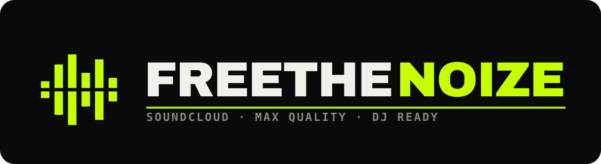

<p align="center">
  
</p>

<p align="center">
  <a href="https://github.com/FreeTheNoize/FreeTheNoize/releases/latest"></a>
  <a href="https://github.com/FreeTheNoize/FreeTheNoize/actions/workflows/ci.yml"></a>
  <a href="LICENSE"></a>
  <a href="CONTRIBUTING.md"></a>
</p>

# FreeTheNoize

Descarga música de SoundCloud a la **máxima calidad disponible**, comprueba qué calidad tiene de verdad y organízala para pinchar.
Funciona como **app de escritorio** (macOS Apple Silicon e Intel, Windows, Linux) o como **servicio web** (Docker, para tenerlo en un servidor o NAS y usarlo desde el móvil).

## Qué hace

- **Descargas** de temas, playlists, álbumes, perfiles, likes y reposts de SoundCloud (y enlaces de YouTube). Descargas en paralelo, cancelar y reintentar, y no vuelve a bajar lo que ya tienes (sin pedírselo de nuevo a SoundCloud).
- **Siempre la mejor fuente**, sin recodificar:
  1. **Original** que subió el artista (WAV/FLAC/AIFF/MP3), si tiene las descargas activadas. Requiere sesión.
  2. **AAC 256 kbps**, con cuenta Go+.
  3. **MP3 128 / AAC 160**, sin cuenta.

  Cada descarga lleva una etiqueta con la calidad real conseguida.
- **BPM y tonalidad** (con notación Camelot) de cada descarga, escritos en las etiquetas para Rekordbox, Traktor y Serato.
- **Metadatos completos**: título, artista, álbum, género, fecha, enlace y carátula en todos los formatos (WAV y AIFF incluidos). Limpia títulos ("[FREE DL]", "Out Now"…) y separa "Artista - Título".
- **Suscripciones**: sigue playlists, likes o perfiles; se revisan solos cada cierto tiempo y bajan solo lo nuevo.
- **Biblioteca** con carátulas, filtro por título/artista/BPM/Camelot y reproductor.
- **Espectro**: espectrograma log/lineal, detección del corte de frecuencias (**falsos lossless**), loudness (LUFS), true peak, LRA y PLR.
- **A/B · Null**: dos versiones lado a lado, escucha A/B instantánea con el volumen igualado y null test (alinea, iguala ganancia y resta; puedes escuchar la diferencia).
- **Conversor** a WAV, AIFF, FLAC, MP3 320 y AAC 256, conservando etiquetas y carátula, con normalización opcional de loudness (−14, −9, −23 LUFS…).
- **Búsqueda** en SoundCloud e **historial**.
- **Pre-escucha** antes de descargar, desde la búsqueda o pegando el enlace (con la sesión de SoundCloud, el tema entero; se puede saltar a cualquier punto).
- yt-dlp **se actualiza desde la propia app**, y la app avisa cuando hay una versión nueva en GitHub (y la descarga si se lo pides; se puede desactivar en Ajustes).

## Escritorio

Descarga la build de [Releases](https://github.com/FreeTheNoize/FreeTheNoize/releases/latest) o, desde el código:

```sh
uv venv && uv pip install -e ".[desktop,dev]"
.venv/bin/freethenoize            # FTN_DEBUG=1 abre el inspector web
```

El inicio de sesión de SoundCloud se hace en una ventana integrada; el token se guarda en el llavero del sistema.

## Servicio web (Docker)

```sh
FTN_PASSWORD=algo-largo docker compose up -d
# → http://localhost:8765
```

o sin compose:

```sh
docker run -d -p 8765:8765 -e FTN_PASSWORD=algo-largo \
  -v ./data:/data -v ./music:/music ghcr.io/freethenoize/freethenoize
```

Sin Docker: `freethenoize serve --host 0.0.0.0 --port 8765 --music-dir ~/Música`.

| Variable | Para qué |
|---|---|
| `FTN_PASSWORD` | Contraseña de acceso. **Ponla siempre** si el servicio es accesible desde la red. |
| `FTN_MUSIC_DIR` | Carpeta de música (en Docker, `/music`). En modo servicio no se puede cambiar desde la página. |
| `FTN_DATA_DIR` | Ajustes, historial, archivo de descargas, suscripciones y caché (en Docker, `/data`). |
| `FTN_SOUNDCLOUD_TOKEN` | Token OAuth de SoundCloud (opcional; también se puede pegar en Ajustes). |
| `FTN_HOST`, `FTN_PORT` | Dónde escucha (por defecto `127.0.0.1:8765`; en Docker `0.0.0.0`). |
| `FTN_TRUSTED_PROXIES` | IPs de tu proxy inverso, para que respete `X-Forwarded-*`. |

En modo servicio solo se puede abrir lo que hay en la carpeta de música y lo que subas desde el navegador (arrastrar archivos funciona). Los resultados se descargan al dispositivo. Para exponerlo fuera de casa, ponlo detrás de un proxy con HTTPS (Caddy, Traefik, Tailscale…).

## Terminal

```sh
freethenoize get https://soundcloud.com/usuario/sets/playlist -o ~/Música
```

Para probar lo último de `develop`: `ghcr.io/freethenoize/freethenoize:edge`.

## Comunidad

FreeTheNoize es un proyecto **libre y horizontal**: no tiene dueño. Lo cuidan maintainers y contributors, que revisan el trabajo
de los demás y deciden juntos quién entra
([GOVERNANCE.md](GOVERNANCE.md)). El objetivo: que cualquier DJ pueda conseguir la mejor calidad que existe de lo que
pincha, saber la verdad sobre esa calidad y tenerlo listo para la cabina, sin anuncios, sin cuentas y sin rastreo.

- 💬 Ideas y dudas: [Discussions](https://github.com/FreeTheNoize/FreeTheNoize/discussions)
- 🐛 Bugs y propuestas: [Issues](https://github.com/FreeTheNoize/FreeTheNoize/issues/new/choose)
- 🔒 Fallos de seguridad: en privado, ver [SECURITY.md](SECURITY.md)

## Cómo aportar

Toda ayuda cuenta: código, probar versiones, reportar enlaces que fallan, revisar PR, traducir o mejorar esta documentación.
La guía completa está en [CONTRIBUTING.md](CONTRIBUTING.md); lo esencial:

1. **Habla antes de lo grande.** Para algo más que un arreglo pequeño, abre un issue o una Discussion primero.
2. **Todo va a `develop`.** Haz la rama desde `develop` y abre la PR contra `develop`. Las PR directas a `main` se rechazan solas.
3. **Título Conventional Commits**: `fix: …`, `feat: …`, `docs: …`. De ahí salen la versión y el CHANGELOG.
4. **PR pequeñas y con tests.** Un propósito por PR; si cambias comportamiento, añade o ajusta tests.
5. **1 aprobación de un maintainer o contributor** distinto de ti y los checks en verde (tests en Linux/macOS/Windows) para fusionar.
   Nadie aprueba lo suyo, tampoco quien fundó el proyecto.
6. **Respeta los principios**: nunca recodificar el audio, decir la verdad sobre la calidad, nada de telemetría ni
   llamadas a terceros nuevas, y el modo servicio seguro por defecto.
7. **Trato humano.** Aplica el [código de conducta](CODE_OF_CONDUCT.md) en todos los espacios del proyecto.

Las releases las prepara un bot: cada cambio en `main` actualiza una PR de release con la versión y el CHANGELOG,
y al aprobarla se publican los zips de escritorio y la imagen Docker. Detalles en [CONTRIBUTING.md › Releases](CONTRIBUTING.md#releases).

## Desarrollo

```sh
git clone https://github.com/FreeTheNoize/FreeTheNoize && cd FreeTheNoize   # rama por defecto: develop
uv venv && uv pip install -e ".[desktop,dev]"
.venv/bin/python -m pytest
.venv/bin/pyinstaller packaging/freethenoize.spec --noconfirm   # build de escritorio
```

```
freethenoize/
  app.py            CLI: app | serve | get
  desktop.py        ventana pywebview + diálogos nativos
  web.py            API HTTP (FastAPI), eventos SSE, auth
  core.py           lógica común a escritorio y servicio
  downloads/        cola, resolución de enlaces, nombres, etiquetas (mutagen)
  analysis/         decodificación, espectrograma, corte, loudness, BPM/tonalidad, null test
  subscriptions.py  sincronización periódica
  library.py        índice de la carpeta de música y carátulas
  converter.py      conversión por lotes y normalización
  ytdlp_loader.py   actualización de yt-dlp en caliente
  ui/               HTML/CSS/JS sin build
```

## Licencia y aviso

[GPL-2.0-or-later](LICENSE). Para uso personal. Descargar contenido que el artista no ha puesto para descargar, o el audio de Go+, puede ir contra los términos de SoundCloud. Apoya a los artistas.
